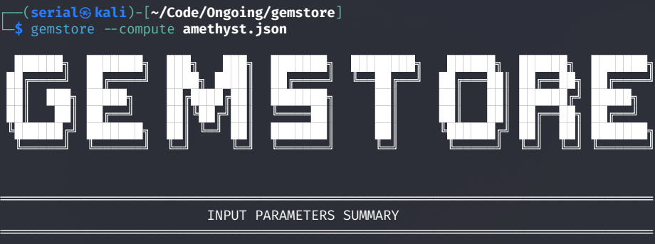

<div align="center">



# GEMSTORE: Hadron Spectroscopy Simulation Tools

[](https://www.gnu.org/licenses/gpl-3.0-or-later)
[](https://en.wikipedia.org/wiki/C_(programming_language))
[](https://en.wikipedia.org/wiki/Unix)


**A computational framework for hadron spectroscopy: Gaussian Expanding Method (GEM) with Godfrey–Isgur potentials, MIT bag and quark-meson-coupling spectra, and molecular states from static one-boson exchange.**

</div>

---

## Overview

**GEMSTORE** computes meson and baryon spectra with the **Gaussian Expanding Method** and **Godfrey–Isgur** (GI-screen / GI-string) and **Cornell** potentials, MIT **bag** masses for mesons through hexaquarks, with or without color–magnetic mixing, **quark-meson coupling** (QMC) spectra of those bags in symmetric nuclear matter, and two- and three-body **molecular** spectra with a static **one-boson-exchange** or local Yukawa kernel.

### Key Features

- 🎯 **Quark models**: GI-Screen, GI-String, NR Cornell, MIT bag, QMC
- 🧲 **Molecular OBE**: static elastic \(\pi\sigma\rho\omega\) for two typed hadron legs
- 📊 **Spectra**: masses, RMS radii (GEM), bag radius and color–spin eigenvectors, molecular binding
- 🧩 **Multiquark bag CMI**: user-supplied color and spin channels, mixed by total spin `st`
- 🔧 **Quantum numbers**: meson \(S,L,J\); baryon Jacobi GEM; bag flavor counts `nn,ns,nc,nb`; molecule legs, isospin, \(J\)
- 🤖 **AI-assisted workflows**: `app/gemstore-assistant`
- ⚡ **C implementation** with Minuit2 for meson parameter fits

---

## Table of Contents

1. [Features](#features)
2. [System Requirements](#system-requirements)
3. [Installation](#installation)
4. [Quick Start](#quick-start)
5. [Core Algorithms](#core-algorithms)
6. [AI Integration](#ai-integration)
7. [Main Functions](#main-functions)
8. [Usage Examples](#usage-examples)
9. [Project Structure](#project-structure)
10. [Contributing](#contributing)
11. [License](#license)

---

## Features

### Physical Models

| Model | Description | Use Case |
|-------|-------------|----------|
| **GI-Screen** | Screen-modified Godfrey-Isgur potential with Coulomb screening | Heavy quarkonium (charmonium, bottomonium) |
| **GI-String** | String-like linear confinement | Light mesons and general meson spectra |
| **NR-String** | Non-relativistic Cornell potential with linear confinement | Meson spectra |
| **NR-Screen** | Non-relativistic Cornell potential with screened confinement | Meson spectra |
| **MIT bag** | Cavity energy plus optional color–magnetic / binding Hamiltonian | Meson, baryon, tetra, penta, hexa |
| **QMC** | MIT bag in symmetric nuclear matter. `QMCSTAD` keeps \(B\) fixed; `QMCMOD` lets \(B\) fall with \(\sigma\) | In-medium bag spectra at \(\rho_B\) and \(T\) |
| **OBE-static** | Elastic static \(\pi\sigma\rho\omega\) (\(V_C+V_{ss}+V_t\), \(V_{ls}=0\)) | Two- and three-body hadron molecules |
| **Yukawa** | Local Malfliet–Tjon Yukawa, central plus Bartlett \(P_\sigma\) | NN and NNN binding (`YUKAWA_MT13`) |
| **EFT contact** | \(V=-C_a\exp[-(r/R_c)^2]\), central only | Yuan–Liu \(DD\) and \(\Lambda_c\Lambda_c\) (`EFTCONT_CUSTOM`) |
| **HAL QCD** | \(V_0+V_\sigma(\sigma_1\cdot\sigma_2)+V_T S_{12}\) from radial tables | Leading-order local potential (`HALQCD_CUSTOM`) |

### Calculation Types

- **SPECTRA**: Mass spectra (meson, baryon, bag, two- and three-body molecule)
- **FITTING**: Minuit2 meson parameter fits

### System Types

- **MESON**: Quark–antiquark (\(q\bar q\))
- **BARYON**: Three-quark (\(qqq\))
- **BAG**: MIT bag (`BAGMIT`) or in-medium QMC (`QMCSTAD`, `QMCMOD`); flavor counts `nn`, `ns`, `nc`, `nb`
- **MOLECUL2**: Two-body molecule (hadron–hadron OBE, Yukawa, EFT contact, or HAL QCD on GEM)
- **MOLECUL3**: Three-body molecule (HYBRID pair OBESTAT, YUKAWA, EFTCONT, or HALQCD on GEM; example `test/Spectra-Molecule3/`)

### Basis Set Options

- **GEM**: Gaussian expansion (meson, baryon, two- and three-body molecule)
- **SHO**: Harmonic oscillator (meson)
- **CMI**: Color–spin product space (bag)
- **NONE**: Bag kinetic plus vacuum energy, no CMI

---

## System Requirements

### Minimum Requirements

- **OS**: Linux/Unix (macOS with GNU tools)
- **Compiler**: GCC 7.0+ or Clang 5.0+
- **Build Tool**: GNU Make 4.0+
- **Memory**: 512 MB RAM
- **Storage**: 100 MB installation + 1 GB for calculations

### Optional Dependencies

- **LAPACK/OpenBLAS**: For accelerated linear algebra
- **Python 3.7+**: For input file generation scripts
- **OpenCode**: For AI-assisted workflow integration

---

## Installation

### Clone the Repository

```bash
git clone --recursive https://github.com/serialcore/gemstore.git
cd gemstore
```

### Build from Source

```bash
# Standard build
make clean && make

# With LAPACK acceleration
make clean && make USE_LAPACKE=1

# Install to system (requires sudo)
make install

# Uninstall from system
make uninstall
```

### Verify Installation

```bash
./gemstore --help
./gemstore --version
```

---

## Quick Start

### Basic Usage

```bash
# Run a meson spectroscopy calculation with JSON input
./gemstore --compute amethyst.json

# Run with predefined parameters
./gemstore --compute diamond.json

# Fit a built-in GISCREEN dataset
./gemstore --compute test/FittingTask/giscreen_csbar.json

# MIT bag with color–spin mixing
./gemstore --compute test/Spectra-Bag/tetra_ccnn_18.json

# Quark-meson coupling at saturation density (zero medium couplings)
./gemstore --compute test/Spectra-QMC/nucleon_qmc.json

# Two-body D* Ξ molecule (static OBE; param file is relative to cwd)
cd test/Spectra-Molecule2
../../gemstore --compute dstar_xi_I0.json
```

### JSON Input Format

GEMSTORE uses JSON for configuration. Create `my_meson.json`:

```json
{
  "project": "my_project",
  "task": "SPECTRA",
  "model": {
    "type": "GISCREEN",
    "param": "GISCREEN_CCBAR"
  },
  "system": {
    "type": "MESON",
    "f1": 3,
    "f2": 3,
    "S": 1,
    "L": 0,
    "J": 1
  },
  "basis": {
    "type": "GEM",
    "nmax": 16,
    "rmax": 30.0,
    "rmin": 0.1
  },
  "print": {
    "pot": "false",
    "wfn": "false"
  }
}
```

Run it:

```bash
./gemstore --compute my_meson.json
```


### JSON Input Structure

#### Global Configuration

| Field | Type | Description | Examples |
|-------|------|-------------|----------|
| `project` | string | Project name (used for output files) | `"amethyst"`, `"myproject"` |
| `task` | string | Calculation type | `"SPECTRA"`, `"FITTING"`, `"SCATTER"` |

#### Model Configuration

```json
"model": {
  "type": "GISCREEN", "GISTRING", "NRSTRING", "NRSCREEN", "BAGMIT", "QMCSTAD", "QMCMOD", or "OBESTAT",
  "param": "GISCREEN_CCBAR", "GISTRING_CUSTOM", "BAGMIT_DEFAULT", "QMCSTAD_DEFAULT", "QMCMOD_CUSTOM", ...,
  "file": "param_file.json"
}
```

**`model.type`:**
- `GISTRING` — relativistic GI model, linear confinement
- `GISCREEN` — relativistic GI model, screened confinement
- `NRSTRING` — non-relativistic Cornell model, linear confinement
- `NRSCREEN` — non-relativistic Cornell model, screened confinement
- `BAGMIT` — MIT bag (`system.type` must be `BAG`)
- `QMCSTAD` — standard quark-meson coupling on `BAG`. \(B\) stays at \(B_0\)
- `QMCMOD` — modified QMC on `BAG`. \(B\) depends on \(\sigma\)
- `OBESTAT` — static elastic OBE (`system.type` `MOLECUL2`, or a HYBRID pair)
- `YUKAWA` — local Yukawa (`MOLECUL2`, or a HYBRID pair)
- `EFTCONT` — leading-order EFT contact (`MOLECUL2`, or a HYBRID pair)
- `HALQCD` — leading-order HAL QCD local potential from radial tables (`MOLECUL2`, or a HYBRID pair)
- `HYBRID` — three pair models for `MOLECUL3`

**Predefined Parameter Sets:**
- `GISCREEN_CCBAR` - Charm-anticharm with GI-Screen model
- `GISCREEN_BBBAR` - Bottom-antibottom with GI-Screen model
- `GISTRING_MESON` - General mesons with GI-String model
- `GISTRING_BARYON` - Smeared linear GI parameters
- `GISCREEN_CUSTOM` - Custom parameters from file (requires `"file"` field)
- `GISTRING_CUSTOM` - Custom GI-String parameters from file
- `NRSTRING_MESON` - Built-in meson parameters for NR-String
- `NRSCREEN_MESON` - Built-in meson parameters for NR-Screen
- `NRSTRING_CUSTOM` - Custom NR-String parameters from file (requires `"file"`)
- `NRSCREEN_CUSTOM` - Custom NR-Screen parameters from file (requires `"file"`)
- `BAGMIT_DEFAULT` - Built-in MIT bag masses, bag constant \(B\), zero-point \(Z\), and pair bindings
- `BAGMIT_CUSTOM` - Custom bag parameters from file (requires `"file"`)
- `QMCSTAD_DEFAULT` - Vacuum MIT bag plus \(m_\sigma=0.550\) GeV and physical \(\omega,\rho\) masses. All medium couplings are 0. `QMCSTAD` only
- `QMCSTAD_CUSTOM` - Standard QMC couplings from file (requires `"file"`). Does not read `g_sigma_B` or `delta`
- `QMCMOD_CUSTOM` - Modified QMC couplings from file (requires `"file"`). Requires `g_sigma_B` \(\neq 0\) and `delta` \(> 0\)
- `OBESTAT_CUSTOM` - Static OBE couplings from file (requires `"file"`)
- `YUKAWA_MT13` - Built-in Malfliet–Tjon I/III (no file)
- `YUKAWA_CUSTOM` - Yukawa terms from file (requires `"file"`)
- `EFTCONT_CUSTOM` - EFT contact \(C_a\) (MeV) and \(R_c\) (fm) from file (requires `"file"`)
- `HALQCD_CUSTOM` - HAL QCD tables \(V_0\), \(V_\sigma\), \(V_T\) (fm, MeV) from file (requires `"file"`)

#### System Configuration

```json
"system": {
  "type": "MESON",
  "f1": <flavor_index>,
  "f2": <flavor_index>,
  "S": <spin>,
  "L": <orbital>,
  "J": <total_angular_momentum>
}
```

**Quark Flavors (indices):**
| Index | Quark | Mass (GeV) |
|-------|-------|-----------|
| 1 | n (up/down) | ~0.3-0.35 |
| 2 | s (strange) | ~0.42-0.53 |
| 3 | c (charm) | ~1.6-1.8 |
| 4 | b (bottom) | ~4.9-5.1 |

**Quantum Numbers:**
- `S`: Spin (0 = singlet, 1 = triplet)
- `L`: Orbital angular momentum (0, 1, 2, ...)
- `J`: Total angular momentum J = L + S or |L - S|

**Baryon** (`"type": "BARYON"`).

```json
"system": {
  "type": "BARYON",
  "f1": 1, "f2": 1, "f3": 3,
  "J": 0.5, "P": 1, "sym12": -1, "Lmax": 0
}
```

`P` is parity. `sym12` is the sign under \(1\leftrightarrow 2\). `Lmax` keeps \(l_\rho+l_\lambda\le L_{\max}\) on three Jacobi charts. Optional `jl` switches to the chart: \(c=1\), \(l_\rho=0\), \(l_\lambda=L_{\max}\). Pair with `GISTRING_BARYON`. `<project>.state.json` stores `mass`, `rms_r12`, `rms_r13`, `rms_r23`. Inputs: `test/Spectra-Baryon/`.

**Bag** (`"type": "BAG"`).

```json
"system": {
  "type": "BAG",
  "nn": 2, "ns": 0, "nc": 2, "nb": 0,
  "f1": 3, "f2": 3, "f3": 1, "f4": 1
}
```

`nn,ns,nc,nb` are required flavor counts. `f1`–`f6` give the quark order for CMI (same flavor indices as mesons) and must match those counts. Omit `f1`–`f6` when `basis` is `NONE`. Inputs: `test/Spectra-Bag/`. Field list: `app/gemstore-assistant/templates/bag_spectra_template.md`.

`QMCSTAD` and `QMCMOD` use the same `BAG` system and add

```json
"rho_b": 0.16,
"temp": 0.0
```

`rho_b` is the baryon density in fm\(^{-3}\) and `temp` is the temperature in GeV. Both are required and must be non-negative. `BAGMIT` does not read them. Basis stays `NONE` or `CMI`. Inputs: `test/Spectra-QMC/`.

**Molecule** (`"type": "MOLECUL2"`). Pair with `"model":{"type":"OBESTAT","param":"OBESTAT_CUSTOM","file":"..."}` and basis `GEM`.

```json
"system": {
  "type": "MOLECUL2",
  "type1": "VECTOR",
  "type2": "DIRAC",
  "m1": 2.010,
  "m2": 1.318,
  "cc1": 0, "cc2": 0,
  "eta": 0,
  "iso_pi": -3,
  "iso_rho": -3,
  "S": 0.5, "L": 0, "J": 0.5
}
```

`type1`/`type2` are `DIRAC` (baryon 1/2), `VECTOR` (1− meson), or `PSEUDOSCALAR` (elastic 0−/0+). `m1`,`m2` are physical masses (GeV) for \(T=m_1+m_2+p^2/2\mu\) and the threshold. Write `iso_pi` and `iso_rho` separately (\(I=0\to-3\), \(I=1\to+1\) for two \(I=1/2\) legs); there is no unified `iso` key. `cc` nonzero on a meson leg flips \(G=-1\) exchanges (\(\pi,\omega\)). `eta` is MM C-parity (`0` is read as `+1`). `L` is the lowest partial wave; the solver mixes \(L\) with \(L+2\) and every total spin that couples to \(J\) (e.g. \(J=1/2\) → \(^2S+^4D\)). JSON `S` does not select the channel list. Example: `test/Spectra-Molecule2/`. Field list: `app/gemstore-assistant/templates/molecule_spectra_template.md`.

#### Basis Configuration

**GEM (Generalized Exponential Morse):**
```json
"basis": {
  "type": "GEM",
  "nmax": 16,
  "rmax": 30.0,
  "rmin": 0.1
}
```

**SHO (Spherical Harmonic Oscillator):**
```json
"basis": {
  "type": "SHO",
  "nmax": 16,
  "beta": 0.8
}
```

**Bag CMI / NONE:**
```json
"basis": {
  "type": "CMI",
  "color": ["tetra11", "tetra88"],
  "spin": [
    {"s12": 1, "s34": 1, "st": 2, "st3": 2}
  ]
}
```

`NONE` has no `color` or `spin`. `CMI` takes 1–8 color names and 1–20 spin channels. Color names: `meson`, `baryon`, `tetra11`, `tetra33`, `tetra66`, `tetra88`, `penta688`, `penta388`, `penta11`, `hexa1010`, `hexa6868`, `hexa6838`, `hexa3868`, `hexa3838`, `hexa11`. Unused spin couplings stay 0. Different `st` do not mix. For five and six quarks the program keeps Pauli-allowed color⊗spin products.

| Field | Type | Description | Range |
|-------|------|-------------|-------|
| `type` | string | Basis set type | `"GEM"`, `"SHO"`, `"CMI"`, `"NONE"` |
| `nmax` | int | Number of basis functions (GEM/SHO) | 8-32 (typical: 16) |
| `rmax` | float | Maximum radius (fm; GEM) | 20.0-50.0 |
| `rmin` | float | Minimum radius (fm; GEM) | 0.01-0.5 |
| `beta` | float | HO scale parameter (GeV; SHO only) | 0.2-2.0 |

#### Print Configuration

Controls output of potential and wavefunction files:

```json
"print": {
  "pot": "true",
  "wfn": "true"
}
```

| Field | Type | Description | Values |
|-------|------|-------------|--------|
| `pot` | string | Whether to write potential file | `"true"` or `"false"` |
| `wfn` | string | Whether to write wavefunction files | `"true"` or `"false"` |

- `"true"` → enabled (1)
- `"false"` → disabled (0)

When enabled:
- Meson potential: `<project>.pot.dat` (`r`, `V`)
- Meson wavefunction: `<project>.wfn.N.dat` (`r`, `R`, `u`, `r²|R|²`), from 0.01 fm to \(\max(10, r_{\max})\) fm (SHO \(r_{\max}=0\) stays at 10 fm)
- Molecule potential: `<project>.pot.dat` (`r`, `Vc`, `Vss`, `Vt`, `V`)
- Molecule wavefunction: `<project>.wfn.N.dat` (one \(R_a\) per partial wave, same radial grid)

### JSON Output Format

`src/write.c` writes `<project>.state.json` (meson, baryon, bag, and two-body molecule). A meson example:

```json
{
  "generated": "2026-04-25 18:33:25",
  "project": "amethyst",
  "task": "SPECTRA",
  "model": { ... },
  "system": { ... },
  "basis": { ... },
  "states": [
    {
      "index": 1,
      "mass": 3.101986299943893,
      "rms_radius": 0.324597538486162,
      "eigenvector": [0.43147459..., 0.56587312..., ...]
    },
    ...
  ]
}
```

**Output Fields:**

| Field | Type | Description |
|-------|------|-------------|
| `generated` | string | ISO 8601 timestamp of calculation |

### Text Output Files (Controlled by `"print"` section)

When `"print":{"pot":"true"}` or `"print":{"wfn":"true"}` is set:

- **Meson potential**: `<project>.pot.dat` — two-column file (`r`, `V(r)`), 0.01–10 fm
- **Meson wavefunction**: `<project>.wfn.N.dat` — `r`, `R`, `u=rR`, `r²|R|²`, from 0.01 fm to \(\max(10, r_{\max})\) fm
- **Molecule potential**: `<project>.pot.dat` — `r`, `Vc`, `Vss`, `Vt`, `V`, 0.01–10 fm
- **Molecule wavefunction**: `<project>.wfn.N.dat` — per-channel \(R_a(r)\) on the same radial grid

**Example output line:**
```text
0.01000000    -0.12345678e+00
```
| `project` | string | Project name (from input) |
| `task` | string | Calculation type (from input) |
| `model` | object | Model configuration (echoed from input) |
| `system` | object | System configuration (echoed from input) |
| `basis` | object | Basis configuration (echoed from input) |
| `states` | array | Array of eigenstate results |

**Per-State Data:**

| Field | Type | Description |
|-------|------|-------------|
| `index` | int | State index (1-based) |
| `mass` | float | Eigenvalue/mass in GeV |
| `rms_radius` | float | Root-mean-square radius in fm |
| `eigenvector` | array | Expansion coefficients (meson: `nmax`; molecule: `nch × nmax`) |

### JSON Parameter File Format

Custom parameters can be supplied via external JSON file:

**param_custom.json:**
```json
{
  "param": {
    "mn": 0.220,
    "ms": 0.419,
    "mc": 1.628,
    "mb": 4.977,
    "b": 0.18,
    "c": -0.253,
    "sigma_0": 1.8,
    "s": 1.55,
    "epsilon_cont": -0.168,
    "epsilon_sov": -0.035,
    "epsilon_sos": 0.055,
    "epsilon_tens": 0.025
  }
}
```

**Reference to custom parameters:**
```json
{
  ...
  "model": {
    "type": "GISTRING",
    "param": "GISTRING_CUSTOM",
    "file": "param_custom.json"
  },
  ...
}
```

**Parameter Definitions:**

| Parameter | Description | Typical Range |
|-----------|-------------|----------------|
| `mn` | Up/down quark mass (GeV) | 0.2-0.35 |
| `ms` | Strange quark mass (GeV) | 0.4-0.6 |
| `mc` | Charm quark mass (GeV) | 1.6-1.8 |
| `mb` | Bottom quark mass (GeV) | 4.9-5.2 |
| `b` | String tension (GI-String) | 0.15-0.25 |
| `mu` | Screening length (GI-Screen) | 0.1-0.2 |
| `c` | Constant offset | -0.7 to 0.0 |
| `sigma_0` | Gaussian smearing width | 1.5-2.0 |
| `s` | Additional smearing parameter | 1.2-1.6 |
| `epsilon_cont` | Contact term strength | -0.3 to 0.0 |
| `epsilon_sov` | Spin-orbit coupling strength | -0.4 to 0.0 |
| `epsilon_sos` | Thomas precession strength | 0.0-1.0 |
| `epsilon_tens` | Tensor force strength | -0.5 to 0.1 |

The GI fields above apply to `GISTRING` and `GISCREEN`. `NRSTRING` and `NRSCREEN` use a different `param` object. `NRSTRING` does not read `mu`. `BAGMIT_CUSTOM` uses the bag table below. `QMCSTAD_CUSTOM` and `QMCMOD_CUSTOM` use the QMC tables. `OBESTAT_CUSTOM` uses the OBE table.

**NRSTRING / NRSCREEN parameter fields:**

| Field | Models | Description |
|-------|--------|-------------|
| `mn` | both | n-quark mass (GeV) |
| `ms` | both | s-quark mass (GeV) |
| `mc` | both | c-quark mass (GeV) |
| `mb` | both | b-quark mass (GeV) |
| `b` | both | String tension (GeV²) |
| `c` | both | Constant potential (GeV) |
| `alpha_s` | both | Constant strong coupling |
| `sigma` | both | Contact smearing (GeV) |
| `mu` | `NRSCREEN` | Screening mass (GeV). `NRSTRING` ignores this field and keeps linear confinement |

**BAGMIT parameter fields** (`BAGMIT_DEFAULT` in `src/param/argset.c`):

| Field | Description |
|-------|-------------|
| `mn`, `ms`, `mc`, `mb` | Quark masses (GeV); default \(m_n=0\) |
| `B` | Bag constant (GeV\(^4\)) |
| `Z` | Zero-point coefficient |
| `Bcs`, `Bbs`, `Bcc`, `Bbc`, `Bbb` | Pair binding strengths (GeV) |

**QMCSTAD parameter fields** (`QMCSTAD_DEFAULT` in `src/param/argset.c`; `QMCSTAD_CUSTOM` via `parse_param_QMC`):

| Field | Description |
|-------|-------------|
| `mn`, `ms`, `mc`, `mb` | Vacuum quark masses (GeV). Default \(m_n=0\), \(m_s=0.279\), \(m_c=1.641\), \(m_b=5.093\) |
| `B` | Vacuum bag constant \(B_0\) (GeV\(^4\)). Default \(4.42051\times 10^{-4}\). \(B\) stays at \(B_0\) |
| `Z` | Zero-point coefficient. Default \(1.83\) |
| `m_sigma`, `m_omega`, `m_rho` | Meson masses (GeV). Defaults \(0.550\), \(0.7825\), \(0.7753\) |
| `g_sigma`, `g_omega`, `g_rho` | Quark–meson couplings. `QMCSTAD_DEFAULT` sets all three to 0 |
| `lambda3` | Cubic scalar self-coupling. Optional; missing means 0 |

`QMCSTAD` does not read `g_sigma_B` or `delta`. A file that contains either field is rejected.

**QMCMOD parameter fields** (`QMCMOD_CUSTOM` via `parse_param_QMC`). The fields above are required, plus:

| Field | Description |
|-------|-------------|
| `g_sigma_B` | Bag-constant coupling. Must be nonzero |
| `delta` | Exponent in \(B(\sigma)\). Must be \(> 0\) |

There is no `QMCMOD` preset. `QMCMOD` cannot use `QMCSTAD_DEFAULT`.

There is no pair-binding block. The mean-field source and the spectrum bag both set those strengths to 0. `g_rho` is stored. Symmetric matter keeps \(\rho_3=0\), so it does not shift the spectrum. A finite \(\sigma\) needs \(m_n>0\) whenever \(g_\sigma\neq 0\). The couplings in `test/Spectra-QMC/param_qmc.json` (\(m_n=0.40\) GeV, \(g_\sigma=4.40\), \(g_\omega=3.95\)) are a saturation sketch, not a published fit.

**OBESTAT parameter fields** (couplings of this pair; legs and isospin stay in the system JSON):

| Field | Description |
|-------|-------------|
| `lambda` | Common monopole cutoff (GeV) |
| `tensor_mass1`, `tensor_mass2` | \(M\) in \(f/(2M)\), Liu Table II convention, not the pole mass |
| `g_pi1`, `g_pi2` | Liu table \(g\); pion vertex conversion is internal |
| `g_sigma1`, `g_sigma2` | Scalar couplings |
| `g_rho1`, `g_rho2`, `f_rho1`, `f_rho2` | Vector \(g\) and magnetic \(f=\kappa g\) |
| `g_omega1`, `g_omega2`, `f_omega1`, `f_omega2` | Same for \(\omega\) |

---

## Core Algorithms

### 1. Gaussian Expanding Method (GEM)

The radial wavefunction is expanded in Gaussian basis functions:

```
ψ(r) = Σ cₙ φₙ(r)
```

where each basis function is:

```
φₙ(r) = r^ℓ exp(-αₙ r²)
```

**Advantages**:
- All integrals solvable in closed form
- Exponential convergence with basis size
- Efficient matrix computations

**Implementation**: `src/basis/orbit.c`, `src/math/integral.c`

### 2. Godfrey-Isgur Quark Model

The GI potential combines three components:

**A. Confinement Potential**
```
V_conf(r) = b₁ · r + b₂ + const
```

**B. Coulomb Interaction**
```
V_coul(r) = -αₛ(r) · Cᶠ / r
```

**C. Hyperfine Interactions**
- Spin-Spin: Contact term
- Spin-Orbit: L·S coupling
- Tensor: Tensor operator

**Implementation**: `src/model/gimodel.c` (20+ potential functions)

### 3. Eigenvalue Problem Solution

Converts the radial Schrödinger equation into a generalized eigenvalue problem:

```
H c = E S c
```

**Algorithm**:
1. Generate Gaussian basis set
2. Compute overlap matrix S (analytically)
3. Compute kinetic energy matrix T (analytically)
4. Compute potential energy matrix V (numerical integration)
5. Solve generalized eigenvalue problem
6. Extract masses and wavefunctions

**Implementation**: `src/math/eigen.c`, `src/model/cmeson.c`, `src/model/cbaryon.c`, `src/model/cmol2.c`

### 4. MIT bag

Bag energy at radius \(R\) (GeV\(^{-1}\)):

```
E0(R) = Σ_f n_f ω_f(R) + (4π/3) B R³ − Z/R
ω_f = sqrt(m_f² + x_f²/R²)
```

\(x_f\) is the ground-state bag frequency. With `CMI`,

```
H(R) = E0(R) I − CMI(R) + Bind
```

Color and spin Casimir factor matrices (`operator_lambda2`, `operator_sigma2`) are built once. \(H(R)\) is assembled and diagonalized inside one `st` block while \(R\) is minimized in \((1,10)\). `NONE` varies \(E_0(R)\) only. Implementation: `src/model/bagmodel.c`, `src/basis/cmisym.c`, `src/math/cmi.c`.

### 4b. Quark-meson coupling

`QMCSTAD` and `QMCMOD` sit on the same bag. `compute_spectra_bag` calls `qmc_solve`, then `bag_compute` at the in-medium light-quark mass and bag constant.

The mean field is symmetric nuclear matter. Its source is always a color-free bag of three light quarks (`NONE`), not the spectrum the user asked for. Only those quarks couple to \(\sigma\). The scalar charge of one \(\kappa=-1\) quark is \(S_q=\partial\omega/\partial m\). The nucleon response is

```
g_N = 3 g_σ S_q − (4π/3) R³ dB/dσ
m_σ² σ + (λ₃/2) σ² = g_N ρ_s
m_n* = m_n − g_σ σ
ω = 3 g_ω ρ_B / m_ω²
```

\(\omega\) stays out of \(E_{\mathrm{bag}}\) and out of the boundary condition. \(\rho_3=0\).

`QMCSTAD` returns \(B=B_0\) and \(dB/d\sigma=0\). `QMCMOD` uses the free source mass \(M_N\) (the three-quark bag at \(\sigma=0\), \(B=B_0\)):

```
B/B0 = (1 − 4 g_σ^B σ / (δ M_N))^δ
```

and rejects a root that would make \(B\le 0\). Temperature enters only the nucleon Fermi–Dirac sea (degeneracy 4). Net density uses \(f-\bar f\); scalar density, energy, and pressure use \(f+\bar f\). At \(T=0\) the sea is a Fermi sphere. \(\sigma=0\) when \(g_\sigma=0\), and when both \(\rho_B\) and \(T\) vanish.

Thermodynamics, with \(U=\tfrac12 m_\sigma^2\sigma^2+(\lambda_3/6)\sigma^3\):

```
ε = ε_kin + U + ½ m_ω² ω²
P = P_kin − U + ½ m_ω² ω²
μ = E_F* + 3 g_ω ω     (T=0; at T>0, E_F* is the kinetic chemical potential ν)
E/A = ε/ρ_B − M_N      (0 at ρ_B = 0)
```

The spectrum then reuses `bag_compute` with \(m_n^*\), \(B(\sigma)\), and the vacuum \(m_s,m_c,m_b,Z\). Quark counts and the `CMI` space come from the input. That mass is not \(M_N+3g_\omega\omega\). For an `nnn` `NONE` bag it coincides with the source mass.

`test/Spectra-QMC/nucleon_qmc.json` is `QMCSTAD_DEFAULT` at \(0.16\,\mathrm{fm}^{-3}\) and \(T=0\): \(\sigma=0\) and \(E/A=+18.9\) MeV, the Fermi kinetic energy of the free bag (\(M_N=1.087\) GeV). `nucleon_qmc_custom.json` uses the sketch couplings and gives \(E/A\approx-16.7\) MeV with pressure near zero. `nucleon_mqmc.json` is the same sketch with \(g_\sigma^B=2\), \(\delta=4\): \(B\) falls to \(0.840\,B_0\) and \(E/A\approx-57.8\) MeV. Implementation: `src/model/qmcmodel.c`.

### 5. Static OBE two-body molecules

The kernel is the static elastic \(\pi\sigma\rho\omega\) potential (Liu / Pavón Valderrama / Geng limit: \(V_{ls}=0\)):

```
H = T + Vc + Vss (s1·s2) + Vt S12
T = m1 + m2 + p² / 2μ
```

Legs are typed (`DIRAC`, `VECTOR`, `PSEUDOSCALAR`), not named as a hadron system. Tensor \(S_{12}\) mixes \(L\) with \(L+2\). The GEM basis is a block of `nch × nmax` Gaussians. Binding is `Ebind = Mass − (m1+m2)`.

**Implementation**: `src/model/obemodel.c`, `src/model/cmol2.c`

### 5b. Yukawa NN / NNN

`MODEL_YUKAWA` is a local potential separate from the molecular OBE. Each term is

```
v(r) = (V / r) exp(-μ r) (W + B P_σ),   P_σ = (1 + σ1·σ2) / 2
```

with `V` in MeV·fm and `μ` in fm⁻¹. `YUKAWA_MT13` is Malfliet–Tjon I/III. Nucleon masses in the sample inputs are 0.938942 GeV so that \(\hbar^2/m_N = 41.47\) MeV·fm². Samples live in `test/Spectra-Yukawa/`. The deuteron (`nmax` 20) gives −2.231 MeV. The triton keeps the local potential in every partial wave. With \(r_{\min}=0.1\) fm and \(r_{\max}=10\) fm, the ground state goes from −5.29 MeV at `nmax` 4 to −8.67 MeV at `nmax` 7 and levels off at −8.88 MeV by `nmax` 10 (the s-wave Faddeev benchmark is −8.54 MeV). `iso_pi` / `iso_rho` are ignored. Two-body entry point is `mol2_yukawa_GEM`; three-body pairs are selected inside `mol3_load_pairs`. Identical Dirac fermions (`sym12` −1) use the sum of Jacobi charts c=1, 2 and 3.

**Implementation**: `src/model/ykwmodel.c`, `src/model/cmol2.c`, `src/model/cmol3.c`

### 5c. EFT contact

`MODEL_EFTCONT` is the leading-order coordinate-space contact of arXiv:2610.28021, Eq. (40):

```
V(r) = -Ca exp(-(r/Rc)^2)
```

`Ca` is in MeV and `Rc` in fm. The normalized Gaussian that replaces \(\delta^{(3)}(\mathbf{r})\) is already absorbed into `Ca`, so \(C_a<0\) is a repulsive well. There is no one-pion exchange and no spin operator, so \(L\) and \(L+2\) do not mix. One parameter file is one projected channel. Samples in `test/Spectra-EFT/` use Yuan–Liu Table I: \(DD\) has \(C_a=-14.652\) MeV, \(R_c=1.0\) fm; \(\Lambda_c\Lambda_c\) has \(C_a=-201.259\) MeV, \(R_c=0.4\) fm. Both are repulsive, so the GEM spectrum stays above threshold. Scattering length and effective range are not computed on this path. Optional `t1`,`t2` default to \(1/2\); identical \(I=0\) baryons set them to `0`.

**Implementation**: `src/model/eftmodel.c`, `src/model/cmol2.c`, `src/model/cmol3.c`

### 5d. HAL QCD

`MODEL_HALQCD` is the leading-order local potential of the Miyamoto thesis, Eq. (3.11):

```
V(r) = V0(r) + Vsig(r) (σ1·σ2) + VT(r) S12
```

`HALQCD_CUSTOM` stores each radial function as `param.V0`, `param.Vsig`, or `param.VT`: an array of `{r, V}` with `r` in fm and `V` in MeV. A missing array is zero. `r` is non-negative and strictly increasing, and each array has at most 256 points. At least one array is required. Between nodes the kernel interpolates linearly. \(r\) at or below the first node keeps \(V(r_1)\). \(r\) at or above the last node is zero. Values enter the Hamiltonian in GeV.

The two-body driver uses the same central, spin–spin, and tensor matrix elements as static OBE. Two Dirac legs put \(\langle\sigma_1\cdot\sigma_2\rangle\) and the Pauli \(S_{12}\) on those operators. \(^1S_0\) therefore sees \(V_0-3V_\sigma\). \(S_{12}\) mixes \(L\) with \(L+2\). There is no \(\mathbf{L}\cdot\mathbf{S}\) term and no coupled-channel potential matrix. Each table is already one isospin projection. A two-body file has one channel, written as `param.V0`, `param.Vsig`, and `param.VT`. A three-body file may instead key those objects by the pair isospin, `"0"`, `"1"`, `"0.5"`, `"1.5"`. Each recoupled \(t_{ij}\) loads its own block. An unlabelled file is accepted only when that pair has one \(t_{ij}\). A missing block stops the run. `iso_pi` and `iso_rho` are parsed and ignored.

`.pot.dat` columns are `r`, `V0`, `Vsig`, `VT`, and `V1S0=V0-3 Vsig`, in GeV. Samples in `test/Spectra-HALQCD/` are software checks. The \(V_0\) table is the repulsive Yuan–Liu \(DD\) Gaussian written as a table, not a lattice HAL QCD potential. Scattering length is a separate `SCATTER` task, not a GEM eigenvalue.

**Implementation**: `src/model/halmodel.c`, `src/model/cmol2.c`, `src/model/cmol3.c`

### 6. Spectral Data Post-Processing

Meson RMS spectra are checked for high-\(n\) anomalies using quadratic interpolation (not used on molecular GEM):

1. **Detect anomalies**: Identify non-monotonic points
2. **Interpolate**: Use Lagrange quadratic/linear interpolation
3. **Validate**: Check normalization and consistency

**Implementation**: `src/math/interplt.c` (enhanced with debugging)

### 7. Parameter Fitting

A fit is a `--compute` run with `"task": "FITTING"`. `fit.target` is a pinned entry such as `GISCREEN_CCBAR`; it names the model and the built-in dataset. JSON does not carry `model` or `system`. The state list and the parameter starts, steps, bounds, and fixed flags are in `src/param/f*.c`.

**Fit function**:
```
χ² = Σᵢ (M_calc^i - M_exp^i)² / σᵢ²
```

Masses in the tables are in MeV. Minuit2 MIGRAD minimizes χ². Each evaluation prints `call N  chi2 = ...`. The minimum is written to `<project>.fit.json`.

**Implementation**: `src/param/fitting.c`, `src/param/minuit.cc`, `src/param/f*.c`

### 8. Scattering length

`"task": "SCATTER"` computes the two-body S-wave scattering length and effective range. The input has `project`, `task`, `model`, and `system`. It does not read `basis` or `print`. The system is `MOLECUL2`. The model is `OBESTAT`, `YUKAWA`, `EFTCONT`, or `HALQCD`. Masses `m1` and `m2` fix the reduced mass. `L` is 0. `S` and `J` select one partial wave.

The radial wave is built by Numerov from that potential, on \(r=0\) to 80 fm with step 0.01 fm and \(\hbar c=197.3\,\mathrm{MeV\cdot fm}\). It is not the GEM molecular wave function. The fit is

\[
k\cot\delta_0=\frac{1}{a_0}+\frac12 r_0 k^2
\]

over \(k=0.05\) to \(0.50\,\mathrm{MeV}\). \(a_0>0\) is attraction. A channel list that also contains \(L=2\) still uses only the diagonal \(\ell=0\) potential. Coulomb is not included. The result file `<project>.scatter.json` holds `mu` in GeV, `a0` in fm, and `r0` in fm.

Yuan–Liu Table I, run from `test/ScatterTask/`: \(DD\) gives \(a_0=-0.250006\,\mathrm{fm}\) and \(r_0=-2.531\,\mathrm{fm}\); \(\Lambda_c\Lambda_c\) gives \(a_0=-0.210000\,\mathrm{fm}\) and \(r_0=-0.170\,\mathrm{fm}\).

**Implementation**: `src/model/cscatter.c`, `src/model/eremodel.c`, `src/model/compute.c`

---

## AI Integration

### OpenCode Assistant for GEMSTORE

The `app/gemstore-assistant/` subdirectory contains an **OpenCode skill** for intelligent task automation.

#### AI Capabilities

```
"Calculate charmonium 1P state with J=1"
         ↓
Parse quantum numbers, select model
         ↓
Generate input file automatically
         ↓
Execute gemstore calculation
         ↓
Parse results, format output
         ↓
"ψ(J^PC) = 1^-- with M = 3.686 GeV"
```

#### Features

- **Natural Language Understanding**: Parse physics requests
- **Automated Workflow**: Generate inputs, execute, parse outputs
- **Systematic Calculations**: Run multiple L, S, J combinations
- **Result Interpretation**: Physics-meaningful explanations
- **Parameter Fitting**: Build a `FITTING` input for a named target such as `GISCREEN_CCBAR` and run it with `--compute`

#### Skill Location

```
app/gemstore-assistant/
├── SKILL.md
├── scripts/generate_meson_inputs.py
└── templates/
    ├── meson_spectra_template.md
    ├── meson_fitting_template.md
    ├── baryon_spectra_template.md
    ├── bag_spectra_template.md
    └── molecule_spectra_template.md
```

#### Usage with OpenCode

```bash
# Enable AI-assisted calculations
opencode "Calculate charmonium spectrum up to L=2"

# Fit a built-in dataset
opencode "Fit GISCREEN_CCBAR on a GEM basis with nmax 20"
```

For details: see `app/gemstore-assistant/SKILL.md`

---

## Main Functions

### Entry Points (src/entry.c)

| Function | Purpose | Call |
|----------|---------|------|
| `entry_compute()` | Spectroscopy or parameter fit | `--compute <file>` |
| `entry_debug()` | Debug calculation steps | `--debug <unit>` |

### Core Spectroscopy (src/model/)

| Function | Algorithm | Output |
|----------|-----------|--------|
| `compute_spectra_meson()` | GEM/SHO meson dispatcher | Masses, RMS, eigenvectors |
| `compute_spectra_baryon()` | Three-quark GI spectrum (GEM) | Masses, pair RMS, eigenvectors |
| `compute_spectra_bag()` | MIT bag and QMC dispatcher | Masses, \(R\), \(x_f\), CMI eigenvectors, QMC matter |
| `qmc_solve()` | Symmetric-matter \(\sigma\), \(\omega\), and in-medium bag | `qmc_matter_t` plus the bag passed to `bag_compute` |
| `compute_spectra_mol2()` | Two-body OBE GEM dispatcher | Mass, Ebind, RMS, mixed-channel eigenvectors |
| `bag_compute()` | Load CMI, mix by `st`, vary \(R\) | `bag_mit_t` states |
| `mol2_obestat_GEM()` | Block GEM \(Hc=ENc\) with \(L\oplus L+2\) | Masses, RMS, overlap |
| `write_meson_spectra()` / `write_bag_spectra()` | JSON in `src/write.c` | `.state.json` |
| `write_mol2_wfn()` | Per-channel radial dump | `.wfn.N.dat` |

### Potential Functions (src/model/gimodel.c)

The implementation includes 22 complete potential components:

**Primary Interactions:**
```c
double GIVconf(double r, ...)     // Confinement (string or screened)
double GIVcoul(double r, ...)     // Coulomb (Gaussian screened)
double GIVcont(double r, ...)     // Contact term (delta-like)
```

**Spin-Dependent Interactions:**
```c
double GIVsovi(double r, ...)     // Spin-orbit coupling (quark 1)
double GIVsovj(double r, ...)     // Spin-orbit coupling (quark 2)
double GIVsovij(double r, ...)    // Mixed spin-orbit coupling
double GIVsosi(double r, ...)     // Thomas precession (quark 1)
double GIVsosj(double r, ...)     // Thomas precession (quark 2)
double GIVtens(double r, ...)     // Tensor force
```

**Smearing Parameters (9 functions):**
Gaussian smearing regularization for all potential components.

### OBE kernel (`src/model/obemodel.c`)

Static elastic \(\pi\sigma\rho\omega\): `OBEVc`, `OBEVss`, `OBEVtens` (`V_{ls}=0`). `write_obe_pot()` dumps `r`, `Vc`, `Vss`, `Vt`, `V`. Couplings live in `argsOBEModel_t`; legs, isospin, and physical masses come from the system JSON.

### Basis Functions (src/basis/)

| Module | Purpose |
|--------|---------|
| `orbit.c` | GEM and SHO orbital basis functions |
| `spin.c` | Spin SU(2) Clebsch-Gordan coefficients |
| `color.c` | SU(3) color wave functions (`color_wfn_push`) |
| `cmisym.c` | CMI color/spin load and Pauli selection |
| `isospin.c` | Isospin basis states |
| `intrin.c` | Intrinsic wavefunction representation |

### Mathematics (src/math/)

| Module | Algorithms |
|--------|-----------|
| `matrix.c` | Linear algebra |
| `eigen.c` | Generalized eigenvalue solver |
| `integral.c` | Gaussian quadrature integration |
| `cmi.c` | Color magnetic interaction |
| `soc.c` | Spin-orbit coupling |
| `su3.c` | SU(3) group operations |
| `interplt.c` | Spectral data interpolation |

---

## Usage Examples

### Example 1: Charmonium Ground State with Predefined Parameters

**Input file** (`cc_ground.json`):
```json
{
  "project": "charmonium_ground",
  "task": "SPECTRA",
  "model": {
    "type": "GISCREEN",
    "param": "GISCREEN_CCBAR"
  },
  "system": {
    "type": "MESON",
    "f1": 3,
    "f2": 3,
    "S": 0,
    "L": 0,
    "J": 0
  },
  "basis": {
    "type": "GEM",
    "nmax": 16,
    "rmax": 30.0,
    "rmin": 0.1
  },
  "print": {
    "pot": "false",
    "wfn": "false"
  }
}
```

**Run**:
```bash
./gemstore --compute cc_ground.json
```

**Output** (`charmonium_ground.state.json`):
```json
{
  "generated": "2026-04-25 18:33:25",
  "project": "charmonium_ground",
  "states": [
    {
      "index": 1,
      "mass": 3.096788,
      "rms_radius": 0.524365,
      "eigenvector": [0.43147..., 0.56587..., ...]
    },
    ...
  ]
}
```

### Example 2: Charmonium with Custom Parameters

**Parameter file** (`my_params.json`):
```json
{
  "param": {
    "mn": 0.220,
    "ms": 0.419,
    "mc": 1.747603574365,
    "mb": 5.095838715,
    "b": 0.248247135518,
    "mu": 0.1333931469096,
    "c": -0.5334999044266,
    "sigma_0": 1.56552865791,
    "s": 1.285723132711,
    "epsilon_cont": -0.2864647624566,
    "epsilon_sov": -0.349573212139,
    "epsilon_sos": 0.7905135472165,
    "epsilon_tens": -0.487322874302
  }
}
```

**Input file** (`cc_custom.json`):
```json
{
  "project": "charmonium_custom",
  "task": "SPECTRA",
  "model": {
    "type": "GISCREEN",
    "param": "GISCREEN_CUSTOM",
    "file": "my_params.json"
  },
  "system": {
    "type": "MESON",
    "f1": 3,
    "f2": 3,
    "S": 1,
    "L": 1,
    "J": 1
  },
  "basis": {
    "type": "GEM",
    "nmax": 16,
    "rmax": 30.0,
    "rmin": 0.1
  },
  "print": {
    "pot": "false",
    "wfn": "false"
  }
}
```

**Run**:
```bash
./gemstore --compute cc_custom.json
```

### Example 3: MIT bag tetraquark

Worked input: `test/Spectra-Bag/tetra_ccnn_18.json`. `NONE` example: `test/Spectra-Bag/baryon_nnn_none.json`.

```bash
./gemstore --compute test/Spectra-Bag/tetra_ccnn_18.json
```

Output `tetra_ccnn_18.state.json` stores `mass`, variational `R`, frequencies `x`, and color–spin eigenvector components. The CLI table prints `st`, mass, \(R\), and \(x_n,x_s,x_c,x_b\).

### Example 3b: QMC nucleon in medium

Worked inputs live in `test/Spectra-QMC/`. `nucleon_qmc.json` is `QMCSTAD` with `QMCSTAD_DEFAULT`. A custom file is `nucleon_qmc_custom.json` plus `param_qmc.json` (`QMCSTAD_CUSTOM`). Modified QMC is `nucleon_mqmc.json` (`QMCMOD`, `QMCMOD_CUSTOM`, `param_mqmc.json`). Color–magnetic mixing is `nucleon_qmc_cmi.json`.

```bash
cd test/Spectra-QMC
../../gemstore --compute nucleon_qmc_custom.json
```

The CLI prints the usual bag table and a `QMC MATTER SUMMARY` (`sigma`, `omega`, `B`, \(m_n^*\), free and in-medium nucleon, scalar density, \(\mu\), \(\varepsilon\), \(P\), \(E/A\)). `<project>.state.json` keeps the bag `states` and adds those matter fields on the root. QMC does not write `.pot.dat` or `.wfn.N.dat`.

### Example 4: Parameter Fitting

`fit.target` selects the pinned dataset. That entry sets the model and the meson state list. Do not write `model`, `system`, or `print`. Basis is `GEM` or `SHO`. The basis below is the one used with these datasets.

**Input file** (`fit_ccbar.json`):
```json
{
  "project": "fit_ccbar",
  "task": "FITTING",
  "fit": { "target": "GISCREEN_CCBAR" },
  "basis": { "type": "GEM", "nmax": 20, "rmax": 30.0, "rmin": 0.1 }
}
```

**Targets**: `GISCREEN_MESON`, `GISCREEN_BBBAR`, `GISCREEN_BCBAR`, `GISCREEN_BSBAR`, `GISCREEN_CCBAR`, `GISCREEN_CSBAR`.

**Run**:
```bash
./gemstore --compute fit_ccbar.json
```

The terminal prints one `call N  chi2 = ...` line per evaluation, then the parameter table, `chi2`, `valid`, and `edm`. Results go to `fit_ccbar.fit.json`. A worked input is `test/FittingTask/giscreen_csbar.json`.

### Example 5: Two-body D* Ξ molecule

Worked input: `test/Spectra-Molecule2/dstar_xi_I0.json` with couplings in `param_OBESTAT_dstarxi.json`.

```bash
cd test/Spectra-Molecule2
../../gemstore --compute dstar_xi_I0.json
```

`model.file` is opened from the current working directory, so this example is run next to `param_OBESTAT_dstarxi.json`. The CLI table prints `Mass`, `Ebind = Mass − (m1+m2)`, and `RMS`. Negative `Ebind` with RMS well below `rmax` is a bound state. Near-threshold RMS \(\approx\) `rmax` is a box state. `"print":{"pot":"true"}` writes `dstar_xi_I0.pot.dat`.

### Example 6: Light Mesons with GI-String Model

For light mesons (pions, kaons), GI-String model works better:

```json
{
  "project": "light_mesons",
  "task": "SPECTRA",
  "model": {
    "type": "GISTRING",
    "param": "GISTRING_MESON"
  },
  "system": {
    "type": "MESON",
    "f1": 1,
    "f2": 1,
    "S": 0,
    "L": 0,
    "J": 0
  },
  "basis": {
    "type": "GEM",
    "nmax": 16,
    "rmax": 30.0,
    "rmin": 0.1
  }
}
```

---

## Output Files

### JSON Output (`.state.json`)

`src/write.c` writes `<project>.state.json` in the current directory:

```bash
./gemstore --compute myfile.json
```

**Output File Structure:**

```json
{
  "generated": "2026-04-25 18:33:25",
  "project": "myproject",
  "task": "SPECTRA",
  "model": {
    "type": "GISCREEN",
    "param": "GISCREEN_CCBAR"
  },
  "system": {
    "type": "MESON",
    "f1": 3,
    "f2": 3,
    "S": 1,
    "L": 0,
    "J": 1
  },
  "basis": {
    "type": "GEM",
    "nmax": 16,
    "rmax": 30,
    "rmin": 0.1
  },
  "states": [
    {
      "index": 1,
      "mass": 3.101986299943893,
      "rms_radius": 0.324597538486162,
      "eigenvector": [0.43147459135290689, 0.56587312869939621, 0.56203519231094468, ...]
    },
    {
      "index": 2,
      "mass": 3.6707285768604248,
      "rms_radius": 0.53640308338098519,
      "eigenvector": [-0.31500074209555717, -0.28193707412502728, 0.0019418306107957378, ...]
    },
    ...
  ]
}
```

**Output Field Definitions:**

| Top-level Field | Type | Content |
|-----------------|------|---------|
| `generated` | string | ISO 8601 timestamp when calculation was performed |
| `project` | string | Project name from input (used as filename base) |
| `task` | string | Calculation type (e.g., `"SPECTRA"`) |
| `model` | object | Model configuration (echoed from input) |
| `system` | object | System quantum numbers (echoed from input) |
| `basis` | object | Basis set configuration (echoed from input) |
| `states` | array | Array of eigenstate results |

**Per-State Fields:**

| State Field | Type | Description |
|-------------|------|-------------|
| `index` | integer | State number (1-based) |
| `mass` | float | Eigenvalue/mass in GeV |
| `rms_radius` | float | Root-mean-square radius in fm |
| `eigenvector` | array | Gaussian expansion coefficients (meson: `nmax`; molecule: `nch × nmax`) |

**Example files:**

- `test/Spectra-CustomParameter/amethyst.state.json` — GEM meson
- `test/Spectra-Bag/*.state.json` — MIT bag (mass, \(R\), \(x\), color–spin components)
- `test/Spectra-QMC/*.state.json` — QMC bag plus root fields `sigma`, `omega`, `B`, `mn_star`, `m_free`, `m_nucleon`, `R_nucleon`, `rho_s`, `mu`, `eps`, `press`, `ebind`
- `test/Spectra-Molecule2/dstar_xi_I0.state.json` — two-body OBE GEM (`mass`, `rms_radius`, mixed-channel `eigenvector`)

Bag states use `st`, `mass`, `R`, `x`, and an `eigenvector` array of `{color, s12, …, c}` objects. `NONE` writes `{c}` only. A QMC file adds the matter fields listed above next to `states`. `R` and `R_nucleon` are in GeV\(^{-1}\). `ebind` is \(E/A\) in GeV.

---

## Project Structure

```
gemstore/
├── README.md
├── LICENSE
├── Makefile
├── include/gemstore/
│   ├── input.h          # argsInput_t (run JSON)
│   ├── parse.h          # input and model-parameter JSON
│   ├── read.h           # result JSON helpers
│   ├── write.h          # <project>.state.json, pot, wfn
│   ├── print.h          # CLI tables
│   ├── types.h
│   ├── basis/           # orbit, spin, color, cmisym, …
│   ├── math/
│   ├── model/           # bagmodel, qmcmodel, cmeson, cbaryon, cmol2, obemodel, compute, …
│   └── param/           # argset, fitting
├── src/                 # mirrors include/; input.c, parse.c, read.c, write.c
├── lib/Minuit2/
├── app/gemstore-assistant/
└── test/
    ├── Spectra-Bag/     # MIT bag
    ├── Spectra-QMC/     # QMCSTAD and QMCMOD on BAG
    ├── Spectra-Baryon/
    ├── Spectra-SHO/
    ├── Spectra-NRmodel/
    ├── Spectra-CustomParameter/
    ├── Spectra-Molecule2/   # two-body OBE GEM
    └── FittingTask/
```

Run JSON is parsed in `src/parse.c` into `argsInput_t` (`include/gemstore/input.h`). Model coefficients live in `src/param/argset.c`. `src/model/compute.c` dispatches meson, baryon, bag (including QMC), and molecular spectra. Result files are written from `src/write.c`; the terminal tables are `src/print.c`.

---

## Building with LAPACK Acceleration

```bash
# Install LAPACK/OpenBLAS (Ubuntu/Debian)
sudo apt-get install liblapacke-dev libopenblas-dev

# Build with LAPACKE support
make clean && make USE_LAPACKE=1
```

---

## Contributing

### Guidelines

1. **Code Style**: K&R style with 4-space indentation
2. **Documentation**: Add docstrings for all public functions
3. **Testing**: Include unit tests for new algorithms
4. **Physics**: Cite literature for new models
5. **Performance**: Profile before optimizing

### Development Workflow

```bash
# Create feature branch
git checkout -b feature/my-algorithm

# Make changes and test
make clean && make

# Commit with descriptive messages
git add -A
git commit -m "Add [feature]: description"

# Push and open pull request
git push origin feature/my-algorithm
```

---

## Citation (not completed)

If you use GEMSTORE in research, please cite:

```bibtex
@software{gemstore2026,
  author = {Zhang, Wen-Xuan},
  title = {GEMSTORE: Hadron Spectroscopy Simulation Tools},
  year = {2026},
  url = {https://github.com/serialcore/gemstore},
  version = {0.1.4},
  note = {GEM, Godfrey-Isgur, MIT bag, QMC, and static OBE molecules}
}
```

### Academic References

1. Godfrey, S., & Isgur, N. (1985). "Mesons in a quark model with chromomagnetic interactions." *Physical Review D, 32*(1), 189.

2. Bhatnagar, V., et al. (1995). "Towards a consistent quark model for baryons." *International Journal of Modern Physics A, 10*(03), 335-392.

3. Fulton, R., et al. (1990). "Gaussian wave packets in the Hilbert space formalism." *Physical Review D*.

4. Chodos, A., Jaffe, R. L., Johnson, K., Thorn, C. B., & Weisskopf, V. F. (1974). "New extended model of hadrons." *Physical Review D, 9*, 3471.

5. Liu, M.-Z., Pan, Y.-W., and Geng, L.-S. (2018). "\(D\Xi\) and \(D^*\Xi\) molecular states from one boson exchange." *Physical Review D, 98*, 014014. [arXiv:1805.08384](https://arxiv.org/abs/1805.08384).

---

## License

**GEMSTORE** is licensed under the **GNU General Public License v3.0 or later** (GPLv3+).

- **SPDX Identifier**: `GPL-3.0-or-later`
- **Full License**: See `LICENSE` file
- **Copyright**: © 2026 Wen-Xuan Zhang

You are free to:
- ✓ Use for any purpose
- ✓ Modify and redistribute
- ✓ Include in research and commercial products

With the requirement that:
- ⚠ Derivative works must also be licensed under GPLv3+
- ⚠ Source code must be provided
- ⚠ License and copyright notice must be preserved

---

## Contact & Support

- **Author**: Wen-Xuan Zhang ([@serialcore](https://github.com/serialcore))
- **Email**: serialcore@outlook.com
- **Issues**: GitHub Issues tracker
- **AI Assistant**: See `app/gemstore-assistant/SKILL.md`

---

<div align="center">

**Made with ❤️ for computational hadron physics**

```
███████████████████████████████████████
████  GEMSTORE v0.1.4                ████
████  Hadron Spectroscopy Tools      ████
███████████████████████████████████████
```

*Last Updated: October 2026*

</div>
