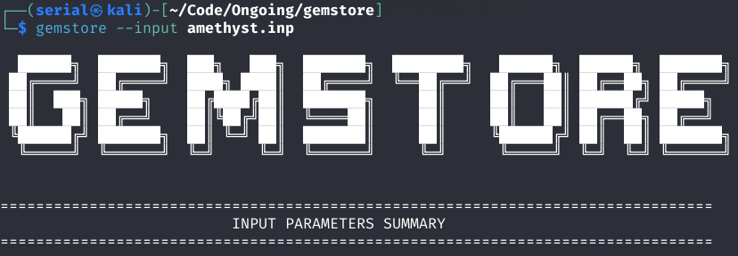

<div align="center">



# GEMSTORE: Hadron Spectroscopy Simulation Tools

[](https://www.gnu.org/licenses/gpl-3.0-or-later)
[](https://en.wikipedia.org/wiki/C_(programming_language))
[](https://en.wikipedia.org/wiki/Unix)


**A computational framework for hadron spectroscopy: Gaussian Expanding Method (GEM) with Godfrey–Isgur potentials, and MIT bag spectra with optional color–spin mixing.**

</div>

---

## Overview

**GEMSTORE** computes meson and baryon spectra with the **Gaussian Expanding Method** and **Godfrey–Isgur** (GI-screen / GI-string) and **Cornell** potentials, and MIT **bag** masses for mesons through hexaquarks, with or without color–magnetic mixing.

### Key Features

- 🎯 **Quark models**: GI-Screen, GI-String, NR Cornell, MIT bag
- 📊 **Spectra**: masses, RMS radii (GEM), bag radius and color–spin eigenvectors
- 🧩 **Multiquark bag CMI**: user-supplied color and spin channels, mixed by total spin `st`
- 🔧 **Quantum numbers**: meson \(S,L,J\); baryon Jacobi GEM; bag flavor counts `nn,ns,nc,nb`
- 🤖 **AI-assisted workflows**: `app/gemstore-assistant`
- ⚡ **C implementation** with Minuit2 for meson parameter fits

---

## Table of Contents

1. [Features](#features)
2. [System Requirements](#system-requirements)
3. [Installation](#installation)
4. [Quick Start](#quick-start)
5. [Core Algorithms](#core-algorithms)
6. [AI Integration](#ai-integration)
7. [Main Functions](#main-functions)
8. [Usage Examples](#usage-examples)
9. [Project Structure](#project-structure)
10. [Contributing](#contributing)
11. [License](#license)

---

## Features

### Physical Models

| Model | Description | Use Case |
|-------|-------------|----------|
| **GI-Screen** | Screen-modified Godfrey-Isgur potential with Coulomb screening | Heavy quarkonium (charmonium, bottomonium) |
| **GI-String** | String-like linear confinement | Light mesons and general meson spectra |
| **NR-String** | Non-relativistic Cornell potential with linear confinement | Meson spectra |
| **NR-Screen** | Non-relativistic Cornell potential with screened confinement | Meson spectra |
| **MIT bag** | Cavity energy plus optional color–magnetic / binding Hamiltonian | Meson, baryon, tetra, penta, hexa |

### Calculation Types

- **SPECTRA**: Mass spectra (meson, baryon, bag)
- **FITTING**: Minuit2 meson parameter fits

### System Types

- **MESON**: Quark–antiquark (\(q\bar q\))
- **BARYON**: Three-quark (\(qqq\))
- **BAG**: MIT bag; flavor content from `nn`, `ns`, `nc`, `nb`

### Basis Set Options

- **GEM**: Gaussian expansion (meson and baryon)
- **SHO**: Harmonic oscillator (meson)
- **CMI**: Color–spin product space (bag)
- **NONE**: Bag kinetic plus vacuum energy, no CMI

---

## System Requirements

### Minimum Requirements

- **OS**: Linux/Unix (macOS with GNU tools)
- **Compiler**: GCC 7.0+ or Clang 5.0+
- **Build Tool**: GNU Make 4.0+
- **Memory**: 512 MB RAM
- **Storage**: 100 MB installation + 1 GB for calculations

### Optional Dependencies

- **LAPACK/OpenBLAS**: For accelerated linear algebra
- **Python 3.7+**: For input file generation scripts
- **OpenCode**: For AI-assisted workflow integration

---

## Installation

### Clone the Repository

```bash
git clone --recursive https://github.com/serialcore/gemstore.git
cd gemstore
```

### Build from Source

```bash
# Standard build
make clean && make

# With LAPACK acceleration
make clean && make USE_LAPACKE=1

# Install to system (requires sudo)
make install

# Uninstall from system
make uninstall
```

### Verify Installation

```bash
./gemstore --help
./gemstore --version
```

---

## Quick Start

### Basic Usage

```bash
# Run a meson spectroscopy calculation with JSON input
./gemstore --compute amethyst.json

# Run with predefined parameters
./gemstore --compute diamond.json

# Fit a built-in GISCREEN dataset
./gemstore --compute test/FittingTask/giscreen_csbar.json

# MIT bag with color–spin mixing
./gemstore --compute test/Spectra-Bag/tetra_ccnn_18.json
```

### JSON Input Format

GEMSTORE uses JSON for configuration. Create `my_meson.json`:

```json
{
  "project": "my_project",
  "task": "SPECTRA",
  "model": {
    "type": "GISCREEN",
    "param": "GISCREEN_CCBAR"
  },
  "system": {
    "type": "MESON",
    "f1": 3,
    "f2": 3,
    "S": 1,
    "L": 0,
    "J": 1
  },
  "basis": {
    "type": "GEM",
    "nmax": 16,
    "rmax": 30.0,
    "rmin": 0.1
  },
  "print": {
    "pot": "false",
    "wfn": "false"
  }
}
```

Run it:

```bash
./gemstore --compute my_meson.json
```


### JSON Input Structure

#### Global Configuration

| Field | Type | Description | Examples |
|-------|------|-------------|----------|
| `project` | string | Project name (used for output files) | `"amethyst"`, `"myproject"` |
| `task` | string | Calculation type | `"SPECTRA"`, `"FITTING"` |

#### Model Configuration

```json
"model": {
  "type": "GISCREEN", "GISTRING", "NRSTRING", "NRSCREEN", or "BAGMIT",
  "param": "GISCREEN_CCBAR", "GISTRING_CUSTOM", "BAGMIT_DEFAULT", ...,
  "file": "param_file.json"
}
```

**`model.type`:**
- `GISTRING` — relativistic GI model, linear confinement
- `GISCREEN` — relativistic GI model, screened confinement
- `NRSTRING` — non-relativistic Cornell model, linear confinement
- `NRSCREEN` — non-relativistic Cornell model, screened confinement
- `BAGMIT` — MIT bag (`system.type` must be `BAG`)

**Predefined Parameter Sets:**
- `GISCREEN_CCBAR` - Charm-anticharm with GI-Screen model
- `GISCREEN_BBBAR` - Bottom-antibottom with GI-Screen model
- `GISTRING_MESON` - General mesons with GI-String model
- `GISTRING_BARYON` - Smeared linear GI parameters
- `GISCREEN_CUSTOM` - Custom parameters from file (requires `"file"` field)
- `GISTRING_CUSTOM` - Custom GI-String parameters from file
- `NRSTRING_MESON` - Built-in meson parameters for NR-String
- `NRSCREEN_MESON` - Built-in meson parameters for NR-Screen
- `NRSTRING_CUSTOM` - Custom NR-String parameters from file (requires `"file"`)
- `NRSCREEN_CUSTOM` - Custom NR-Screen parameters from file (requires `"file"`)
- `BAGMIT_DEFAULT` - Built-in MIT bag masses, bag constant \(B\), zero-point \(Z\), and pair bindings
- `BAGMIT_CUSTOM` - Custom bag parameters from file (requires `"file"`)

#### System Configuration

```json
"system": {
  "type": "MESON",
  "f1": <flavor_index>,
  "f2": <flavor_index>,
  "S": <spin>,
  "L": <orbital>,
  "J": <total_angular_momentum>
}
```

**Quark Flavors (indices):**
| Index | Quark | Mass (GeV) |
|-------|-------|-----------|
| 1 | n (up/down) | ~0.3-0.35 |
| 2 | s (strange) | ~0.42-0.53 |
| 3 | c (charm) | ~1.6-1.8 |
| 4 | b (bottom) | ~4.9-5.1 |

**Quantum Numbers:**
- `S`: Spin (0 = singlet, 1 = triplet)
- `L`: Orbital angular momentum (0, 1, 2, ...)
- `J`: Total angular momentum J = L + S or |L - S|

**Baryon** (`"type": "BARYON"`).

```json
"system": {
  "type": "BARYON",
  "f1": 1, "f2": 1, "f3": 3,
  "J": 0.5, "P": 1, "sym12": -1, "Lmax": 0
}
```

`P` is parity. `sym12` is the sign under \(1\leftrightarrow 2\). `Lmax` keeps \(l_\rho+l_\lambda\le L_{\max}\) on three Jacobi charts. Optional `jl` switches to the chart: \(c=1\), \(l_\rho=0\), \(l_\lambda=L_{\max}\). Pair with `GISTRING_BARYON`. `<project>.state.json` stores `mass`, `rms_r12`, `rms_r13`, `rms_r23`. Inputs: `test/Spectra-Baryon/`.

**Bag** (`"type": "BAG"`).

```json
"system": {
  "type": "BAG",
  "nn": 2, "ns": 0, "nc": 2, "nb": 0,
  "f1": 3, "f2": 3, "f3": 1, "f4": 1
}
```

`nn,ns,nc,nb` are required flavor counts. `f1`–`f6` give the quark order for CMI (same flavor indices as mesons) and must match those counts. Omit `f1`–`f6` when `basis` is `NONE`. Inputs: `test/Spectra-Bag/`. Field list: `app/gemstore-assistant/templates/bag_spectra_template.md`.

#### Basis Configuration

**GEM (Generalized Exponential Morse):**
```json
"basis": {
  "type": "GEM",
  "nmax": 16,
  "rmax": 30.0,
  "rmin": 0.1
}
```

**SHO (Spherical Harmonic Oscillator):**
```json
"basis": {
  "type": "SHO",
  "nmax": 16,
  "beta": 0.8
}
```

**Bag CMI / NONE:**
```json
"basis": {
  "type": "CMI",
  "color": ["tetra11", "tetra88"],
  "spin": [
    {"s12": 1, "s34": 1, "st": 2, "st3": 2}
  ]
}
```

`NONE` has no `color` or `spin`. `CMI` takes 1–8 color names and 1–20 spin channels. Color names: `meson`, `baryon`, `tetra11`, `tetra33`, `tetra66`, `tetra88`, `penta688`, `penta388`, `penta11`, `hexa1010`, `hexa6868`, `hexa6838`, `hexa3868`, `hexa3838`, `hexa11`. Unused spin couplings stay 0. Different `st` do not mix. For five and six quarks the program keeps Pauli-allowed color⊗spin products.

| Field | Type | Description | Range |
|-------|------|-------------|-------|
| `type` | string | Basis set type | `"GEM"`, `"SHO"`, `"CMI"`, `"NONE"` |
| `nmax` | int | Number of basis functions (GEM/SHO) | 8-32 (typical: 16) |
| `rmax` | float | Maximum radius (fm; GEM) | 20.0-50.0 |
| `rmin` | float | Minimum radius (fm; GEM) | 0.01-0.5 |
| `beta` | float | HO scale parameter (GeV; SHO only) | 0.2-2.0 |

#### Print Configuration

Controls output of potential and wavefunction files:

```json
"print": {
  "pot": "true",
  "wfn": "true"
}
```

| Field | Type | Description | Values |
|-------|------|-------------|--------|
| `pot` | string | Whether to write potential file | `"true"` or `"false"` |
| `wfn` | string | Whether to write wavefunction files | `"true"` or `"false"` |

- `"true"` → enabled (1)
- `"false"` → disabled (0)

When enabled:
- Potential: `<project>.pot.dat` (r, V)
- Wavefunction: `<project>.wfn.N.dat` (one file per state, r, φ(r))

### JSON Output Format

`src/write.c` writes `<project>.state.json` (meson, baryon, and bag). A meson example:

```json
{
  "generated": "2026-04-25 18:33:25",
  "project": "amethyst",
  "task": "SPECTRA",
  "model": { ... },
  "system": { ... },
  "basis": { ... },
  "states": [
    {
      "index": 1,
      "mass": 3.101986299943893,
      "rms_radius": 0.324597538486162,
      "eigenvector": [0.43147459..., 0.56587312..., ...]
    },
    ...
  ]
}
```

**Output Fields:**

| Field | Type | Description |
|-------|------|-------------|
| `generated` | string | ISO 8601 timestamp of calculation |

### Text Output Files (Controlled by `"print"` section)

When `"print":{"pot":"true"}` or `"print":{"wfn":"true"}` is set:

- **Potential**: `<project>.pot.dat` — two-column file (`r`, `V(r)`)
- **Wavefunction**: `<project>.wfn.N.dat` — one file per state (`r`, `φ(r)`)

Both files contain exactly 990 lines with `r` from 0.01 fm to 10.0 fm (Δr = 0.01 fm), matching the format used by Origin and similar plotting tools.

**Example output line:**
```text
0.01000000    -0.12345678e+00
```
| `project` | string | Project name (from input) |
| `task` | string | Calculation type (from input) |
| `model` | object | Model configuration (echoed from input) |
| `system` | object | System configuration (echoed from input) |
| `basis` | object | Basis configuration (echoed from input) |
| `states` | array | Array of eigenstate results |

**Per-State Data:**

| Field | Type | Description |
|-------|------|-------------|
| `index` | int | State index (1 to nmax) |
| `mass` | float | Eigenvalue/mass in GeV |
| `rms_radius` | float | Root-mean-square radius in fm |
| `eigenvector` | array | Expansion coefficients (length = nmax) |

### JSON Parameter File Format

Custom parameters can be supplied via external JSON file:

**param_custom.json:**
```json
{
  "param": {
    "mn": 0.220,
    "ms": 0.419,
    "mc": 1.628,
    "mb": 4.977,
    "b": 0.18,
    "c": -0.253,
    "sigma_0": 1.8,
    "s": 1.55,
    "epsilon_cont": -0.168,
    "epsilon_sov": -0.035,
    "epsilon_sos": 0.055,
    "epsilon_tens": 0.025
  }
}
```

**Reference to custom parameters:**
```json
{
  ...
  "model": {
    "type": "GISTRING",
    "param": "GISTRING_CUSTOM",
    "file": "param_custom.json"
  },
  ...
}
```

**Parameter Definitions:**

| Parameter | Description | Typical Range |
|-----------|-------------|----------------|
| `mn` | Up/down quark mass (GeV) | 0.2-0.35 |
| `ms` | Strange quark mass (GeV) | 0.4-0.6 |
| `mc` | Charm quark mass (GeV) | 1.6-1.8 |
| `mb` | Bottom quark mass (GeV) | 4.9-5.2 |
| `b` | String tension (GI-String) | 0.15-0.25 |
| `mu` | Screening length (GI-Screen) | 0.1-0.2 |
| `c` | Constant offset | -0.7 to 0.0 |
| `sigma_0` | Gaussian smearing width | 1.5-2.0 |
| `s` | Additional smearing parameter | 1.2-1.6 |
| `epsilon_cont` | Contact term strength | -0.3 to 0.0 |
| `epsilon_sov` | Spin-orbit coupling strength | -0.4 to 0.0 |
| `epsilon_sos` | Thomas precession strength | 0.0-1.0 |
| `epsilon_tens` | Tensor force strength | -0.5 to 0.1 |

The GI fields above apply to `GISTRING` and `GISCREEN`. `NRSTRING` and `NRSCREEN` use a different `param` object. `NRSTRING` does not read `mu`. `BAGMIT_CUSTOM` uses the bag table below.

**NRSTRING / NRSCREEN parameter fields:**

| Field | Models | Description |
|-------|--------|-------------|
| `mn` | both | n-quark mass (GeV) |
| `ms` | both | s-quark mass (GeV) |
| `mc` | both | c-quark mass (GeV) |
| `mb` | both | b-quark mass (GeV) |
| `b` | both | String tension (GeV²) |
| `c` | both | Constant potential (GeV) |
| `alpha_s` | both | Constant strong coupling |
| `sigma` | both | Contact smearing (GeV) |
| `mu` | `NRSCREEN` | Screening mass (GeV). `NRSTRING` ignores this field and keeps linear confinement |

**BAGMIT parameter fields** (`BAGMIT_DEFAULT` in `src/param/argset.c`):

| Field | Description |
|-------|-------------|
| `mn`, `ms`, `mc`, `mb` | Quark masses (GeV); default \(m_n=0\) |
| `B` | Bag constant (GeV\(^4\)) |
| `Z` | Zero-point coefficient |
| `Bcs`, `Bbs`, `Bcc`, `Bbc`, `Bbb` | Pair binding strengths (GeV) |

---

## Core Algorithms

### 1. Gaussian Expanding Method (GEM)

The radial wavefunction is expanded in Gaussian basis functions:

```
ψ(r) = Σ cₙ φₙ(r)
```

where each basis function is:

```
φₙ(r) = r^ℓ exp(-αₙ r²)
```

**Advantages**:
- All integrals solvable in closed form
- Exponential convergence with basis size
- Efficient matrix computations

**Implementation**: `src/basis/orbit.c`, `src/math/integral.c`

### 2. Godfrey-Isgur Quark Model

The GI potential combines three components:

**A. Confinement Potential**
```
V_conf(r) = b₁ · r + b₂ + const
```

**B. Coulomb Interaction**
```
V_coul(r) = -αₛ(r) · Cᶠ / r
```

**C. Hyperfine Interactions**
- Spin-Spin: Contact term
- Spin-Orbit: L·S coupling
- Tensor: Tensor operator

**Implementation**: `src/model/gimodel.c` (20+ potential functions)

### 3. Eigenvalue Problem Solution

Converts the radial Schrödinger equation into a generalized eigenvalue problem:

```
H c = E S c
```

**Algorithm**:
1. Generate Gaussian basis set
2. Compute overlap matrix S (analytically)
3. Compute kinetic energy matrix T (analytically)
4. Compute potential energy matrix V (numerical integration)
5. Solve generalized eigenvalue problem
6. Extract masses and wavefunctions

**Implementation**: `src/math/eigen.c`, `src/model/cmeson.c`, `src/model/cbaryon.c`

### 4. MIT bag

Bag energy at radius \(R\) (GeV\(^{-1}\)):

```
E0(R) = Σ_f n_f ω_f(R) + (4π/3) B R³ − Z/R
ω_f = sqrt(m_f² + x_f²/R²)
```

\(x_f\) is the ground-state bag frequency. With `CMI`,

```
H(R) = E0(R) I − CMI(R) + Bind
```

Color and spin Casimir factor matrices (`operator_lambda2`, `operator_sigma2`) are built once. \(H(R)\) is assembled and diagonalized inside one `st` block while \(R\) is minimized in \((1,10)\). `NONE` varies \(E_0(R)\) only. Implementation: `src/model/bagmodel.c`, `src/basis/cmisym.c`, `src/math/cmi.c`.

### 5. Spectral Data Post-Processing

The RMS radius spectrum is analyzed for anomalies using quadratic interpolation:

1. **Detect anomalies**: Identify non-monotonic points
2. **Interpolate**: Use Lagrange quadratic/linear interpolation
3. **Validate**: Check normalization and consistency

**Implementation**: `src/math/interplt.c` (enhanced with debugging)

### 6. Parameter Fitting

A fit is a `--compute` run with `"task": "FITTING"`. `fit.target` names both the model and the built-in dataset, for example `GISCREEN_CCBAR`. The state list and the parameter starts, steps, bounds, and fixed flags are in `src/param/f*.c`.

**Fit function**:
```
χ² = Σᵢ (M_calc^i - M_exp^i)² / σᵢ²
```

Masses in the tables are in MeV. Minuit2 MIGRAD minimizes χ². Each evaluation prints `call N  chi2 = ...`. The minimum is written to `<project>.fit.json`.

**Implementation**: `src/param/fitting.c`, `src/param/minuit.cc`, `src/param/f*.c`

---

## AI Integration

### OpenCode Assistant for GEMSTORE

The `app/gemstore-assistant/` subdirectory contains an **OpenCode skill** for intelligent task automation.

#### AI Capabilities

```
"Calculate charmonium 1P state with J=1"
         ↓
Parse quantum numbers, select model
         ↓
Generate input file automatically
         ↓
Execute gemstore calculation
         ↓
Parse results, format output
         ↓
"ψ(J^PC) = 1^-- with M = 3.686 GeV"
```

#### Features

- **Natural Language Understanding**: Parse physics requests
- **Automated Workflow**: Generate inputs, execute, parse outputs
- **Systematic Calculations**: Run multiple L, S, J combinations
- **Result Interpretation**: Physics-meaningful explanations
- **Parameter Fitting**: Build a `FITTING` input for a named target such as `GISCREEN_CCBAR` and run it with `--compute`

#### Skill Location

```
app/gemstore-assistant/
├── SKILL.md
├── scripts/generate_meson_inputs.py
└── templates/
    ├── meson_spectra_template.md
    ├── meson_fitting_template.md
    ├── baryon_spectra_template.md
    └── bag_spectra_template.md
```

#### Usage with OpenCode

```bash
# Enable AI-assisted calculations
opencode "Calculate charmonium spectrum up to L=2"

# Fit a built-in dataset
opencode "Fit GISCREEN_CCBAR on a GEM basis with nmax 20"
```

For details: see `app/gemstore-assistant/SKILL.md`

---

## Main Functions

### Entry Points (src/entry.c)

| Function | Purpose | Call |
|----------|---------|------|
| `entry_compute()` | Spectroscopy or parameter fit | `--compute <file>` |
| `entry_debug()` | Debug calculation steps | `--debug <unit>` |

### Core Spectroscopy (src/model/)

| Function | Algorithm | Output |
|----------|-----------|--------|
| `compute_spectra_meson()` | GEM/SHO meson dispatcher | Masses, RMS, eigenvectors |
| `compute_spectra_baryon()` | Three-quark GI spectrum (GEM) | Masses, pair RMS, eigenvectors |
| `compute_spectra_bag()` | MIT bag dispatcher | Masses, \(R\), \(x_f\), CMI eigenvectors |
| `bag_compute()` | Load CMI, mix by `st`, vary \(R\) | `bag_mit_t` states |
| `write_meson_spectra()` / `write_bag_spectra()` | JSON in `src/write.c` | `.state.json` |

### Potential Functions (src/model/gimodel.c)

The implementation includes 22 complete potential components:

**Primary Interactions:**
```c
double GIVconf(double r, ...)     // Confinement (string or screened)
double GIVcoul(double r, ...)     // Coulomb (Gaussian screened)
double GIVcont(double r, ...)     // Contact term (delta-like)
```

**Spin-Dependent Interactions:**
```c
double GIVsovi(double r, ...)     // Spin-orbit coupling (quark 1)
double GIVsovj(double r, ...)     // Spin-orbit coupling (quark 2)
double GIVsovij(double r, ...)    // Mixed spin-orbit coupling
double GIVsosi(double r, ...)     // Thomas precession (quark 1)
double GIVsosj(double r, ...)     // Thomas precession (quark 2)
double GIVtens(double r, ...)     // Tensor force
```

**Smearing Parameters (9 functions):**
Gaussian smearing regularization for all potential components.

### Basis Functions (src/basis/)

| Module | Purpose |
|--------|---------|
| `orbit.c` | GEM and SHO orbital basis functions |
| `spin.c` | Spin SU(2) Clebsch-Gordan coefficients |
| `color.c` | SU(3) color wave functions (`color_wfn_push`) |
| `cmisym.c` | CMI color/spin load and Pauli selection |
| `isospin.c` | Isospin basis states |
| `intrin.c` | Intrinsic wavefunction representation |

### Mathematics (src/math/)

| Module | Algorithms |
|--------|-----------|
| `matrix.c` | Linear algebra |
| `eigen.c` | Generalized eigenvalue solver |
| `integral.c` | Gaussian quadrature integration |
| `cmi.c` | Color magnetic interaction |
| `soc.c` | Spin-orbit coupling |
| `su3.c` | SU(3) group operations |
| `interplt.c` | Spectral data interpolation |

---

## Usage Examples

### Example 1: Charmonium Ground State with Predefined Parameters

**Input file** (`cc_ground.json`):
```json
{
  "project": "charmonium_ground",
  "task": "SPECTRA",
  "model": {
    "type": "GISCREEN",
    "param": "GISCREEN_CCBAR"
  },
  "system": {
    "type": "MESON",
    "f1": 3,
    "f2": 3,
    "S": 0,
    "L": 0,
    "J": 0
  },
  "basis": {
    "type": "GEM",
    "nmax": 16,
    "rmax": 30.0,
    "rmin": 0.1
  },
  "print": {
    "pot": "false",
    "wfn": "false"
  }
}
```

**Run**:
```bash
./gemstore --compute cc_ground.json
```

**Output** (`charmonium_ground.state.json`):
```json
{
  "generated": "2026-04-25 18:33:25",
  "project": "charmonium_ground",
  "states": [
    {
      "index": 1,
      "mass": 3.096788,
      "rms_radius": 0.524365,
      "eigenvector": [0.43147..., 0.56587..., ...]
    },
    ...
  ]
}
```

### Example 2: Charmonium with Custom Parameters

**Parameter file** (`my_params.json`):
```json
{
  "param": {
    "mn": 0.220,
    "ms": 0.419,
    "mc": 1.747603574365,
    "mb": 5.095838715,
    "b": 0.248247135518,
    "mu": 0.1333931469096,
    "c": -0.5334999044266,
    "sigma_0": 1.56552865791,
    "s": 1.285723132711,
    "epsilon_cont": -0.2864647624566,
    "epsilon_sov": -0.349573212139,
    "epsilon_sos": 0.7905135472165,
    "epsilon_tens": -0.487322874302
  }
}
```

**Input file** (`cc_custom.json`):
```json
{
  "project": "charmonium_custom",
  "task": "SPECTRA",
  "model": {
    "type": "GISCREEN",
    "param": "GISCREEN_CUSTOM",
    "file": "my_params.json"
  },
  "system": {
    "type": "MESON",
    "f1": 3,
    "f2": 3,
    "S": 1,
    "L": 1,
    "J": 1
  },
  "basis": {
    "type": "GEM",
    "nmax": 16,
    "rmax": 30.0,
    "rmin": 0.1
  },
  "print": {
    "pot": "false",
    "wfn": "false"
  }
}
```

**Run**:
```bash
./gemstore --compute cc_custom.json
```

### Example 3: MIT bag tetraquark

Worked input: `test/Spectra-Bag/tetra_ccnn_18.json`. `NONE` example: `test/Spectra-Bag/baryon_nnn_none.json`.

```bash
./gemstore --compute test/Spectra-Bag/tetra_ccnn_18.json
```

Output `tetra_ccnn_18.state.json` stores `mass`, variational `R`, frequencies `x`, and color–spin eigenvector components. The CLI table prints `st`, mass, \(R\), and \(x_n,x_s,x_c,x_b\).

### Example 4: Parameter Fitting

`model` gives the type only. `system` gives the type only. `fit.target` selects the dataset. These targets are meson fits, so `system.type` is `MESON` and `model.type` matches the model in the target name. Basis is `GEM` or `SHO`. The basis below is the one used with these datasets.

**Input file** (`fit_ccbar.json`):
```json
{
  "project": "fit_ccbar",
  "task": "FITTING",
  "model": { "type": "GISCREEN" },
  "system": { "type": "MESON" },
  "basis": { "type": "GEM", "nmax": 20, "rmax": 30.0, "rmin": 0.1 },
  "print": { "pot": "false", "wfn": "false" },
  "fit": { "target": "GISCREEN_CCBAR" }
}
```

**Targets**: `GISCREEN_MESON`, `GISCREEN_BBBAR`, `GISCREEN_BCBAR`, `GISCREEN_BSBAR`, `GISCREEN_CCBAR`, `GISCREEN_CSBAR`.

**Run**:
```bash
./gemstore --compute fit_ccbar.json
```

The terminal prints one `call N  chi2 = ...` line per evaluation, then the parameter table, `chi2`, `valid`, and `edm`. Results go to `fit_ccbar.fit.json`. A worked input is `test/FittingTask/giscreen_csbar.json`.

### Example 5: Light Mesons with GI-String Model

For light mesons (pions, kaons), GI-String model works better:

```json
{
  "project": "light_mesons",
  "task": "SPECTRA",
  "model": {
    "type": "GISTRING",
    "param": "GISTRING_MESON"
  },
  "system": {
    "type": "MESON",
    "f1": 1,
    "f2": 1,
    "S": 0,
    "L": 0,
    "J": 0
  },
  "basis": {
    "type": "GEM",
    "nmax": 16,
    "rmax": 30.0,
    "rmin": 0.1
  }
}
```

---

## Output Files

### JSON Output (`.state.json`)

`src/write.c` writes `<project>.state.json` in the current directory:

```bash
./gemstore --compute myfile.json
```

**Output File Structure:**

```json
{
  "generated": "2026-04-25 18:33:25",
  "project": "myproject",
  "task": "SPECTRA",
  "model": {
    "type": "GISCREEN",
    "param": "GISCREEN_CCBAR"
  },
  "system": {
    "type": "MESON",
    "f1": 3,
    "f2": 3,
    "S": 1,
    "L": 0,
    "J": 1
  },
  "basis": {
    "type": "GEM",
    "nmax": 16,
    "rmax": 30,
    "rmin": 0.1
  },
  "states": [
    {
      "index": 1,
      "mass": 3.101986299943893,
      "rms_radius": 0.324597538486162,
      "eigenvector": [0.43147459135290689, 0.56587312869939621, 0.56203519231094468, ...]
    },
    {
      "index": 2,
      "mass": 3.6707285768604248,
      "rms_radius": 0.53640308338098519,
      "eigenvector": [-0.31500074209555717, -0.28193707412502728, 0.0019418306107957378, ...]
    },
    ...
  ]
}
```

**Output Field Definitions:**

| Top-level Field | Type | Content |
|-----------------|------|---------|
| `generated` | string | ISO 8601 timestamp when calculation was performed |
| `project` | string | Project name from input (used as filename base) |
| `task` | string | Calculation type (e.g., `"SPECTRA"`) |
| `model` | object | Model configuration (echoed from input) |
| `system` | object | System quantum numbers (echoed from input) |
| `basis` | object | Basis set configuration (echoed from input) |
| `states` | array | Array of eigenstate results |

**Per-State Fields:**

| State Field | Type | Description |
|-------------|------|-------------|
| `index` | integer | State number (1 to nmax) |
| `mass` | float | Eigenvalue/mass in GeV |
| `rms_radius` | float | Root-mean-square radius in fm |
| `eigenvector` | array | Gaussian expansion coefficients (length = nmax) |

**Example files:**

- `test/Spectra-CustomParameter/amethyst.state.json` — GEM meson
- `test/Spectra-Bag/*.state.json` — MIT bag (mass, \(R\), \(x\), color–spin components)

Bag states use `st`, `mass`, `R`, `x`, and an `eigenvector` array of `{color, s12, …, c}` objects. `NONE` writes `{c}` only.

---

## Project Structure

```
gemstore/
├── README.md
├── LICENSE
├── Makefile
├── include/gemstore/
│   ├── input.h          # argsInput_t (run JSON)
│   ├── parse.h          # input and model-parameter JSON
│   ├── read.h           # result JSON helpers
│   ├── write.h          # <project>.state.json, pot, wfn
│   ├── print.h          # CLI tables
│   ├── types.h
│   ├── basis/           # orbit, spin, color, cmisym, …
│   ├── math/
│   ├── model/           # bagmodel, cmeson, cbaryon, compute, …
│   └── param/           # argset, fitting
├── src/                 # mirrors include/; input.c, parse.c, read.c, write.c
├── lib/Minuit2/
├── app/gemstore-assistant/
└── test/
    ├── Spectra-Bag/     # MIT bag
    ├── Spectra-Baryon/
    ├── Spectra-SHO/
    ├── Spectra-NRmodel/
    ├── Spectra-CustomParameter/
    └── FittingTask/
```

Run JSON is parsed in `src/parse.c` into `argsInput_t` (`include/gemstore/input.h`). Model coefficients live in `src/param/argset.c`. `src/model/compute.c` dispatches meson, baryon, and bag. Result files are written from `src/write.c`; the terminal tables are `src/print.c`.

---

## Building with LAPACK Acceleration

```bash
# Install LAPACK/OpenBLAS (Ubuntu/Debian)
sudo apt-get install liblapacke-dev libopenblas-dev

# Build with LAPACKE support
make clean && make USE_LAPACKE=1
```

---

## Contributing

### Guidelines

1. **Code Style**: K&R style with 4-space indentation
2. **Documentation**: Add docstrings for all public functions
3. **Testing**: Include unit tests for new algorithms
4. **Physics**: Cite literature for new models
5. **Performance**: Profile before optimizing

### Development Workflow

```bash
# Create feature branch
git checkout -b feature/my-algorithm

# Make changes and test
make clean && make

# Commit with descriptive messages
git add -A
git commit -m "Add [feature]: description"

# Push and open pull request
git push origin feature/my-algorithm
```

---

## Citation (not completed)

If you use GEMSTORE in research, please cite:

```bibtex
@software{gemstore2026,
  author = {Zhang, Wen-Xuan},
  title = {GEMSTORE: Hadron Spectroscopy Simulation Tools},
  year = {2026},
  url = {https://github.com/serialcore/gemstore},
  version = {0.1.4},
  note = {GEM, Godfrey-Isgur, and MIT bag spectroscopy}
}
```

### Academic References

1. Godfrey, S., & Isgur, N. (1985). "Mesons in a quark model with chromomagnetic interactions." *Physical Review D, 32*(1), 189.

2. Bhatnagar, V., et al. (1995). "Towards a consistent quark model for baryons." *International Journal of Modern Physics A, 10*(03), 335-392.

3. Fulton, R., et al. (1990). "Gaussian wave packets in the Hilbert space formalism." *Physical Review D*.

4. Chodos, A., Jaffe, R. L., Johnson, K., Thorn, C. B., & Weisskopf, V. F. (1974). "New extended model of hadrons." *Physical Review D, 9*, 3471.

---

## License

**GEMSTORE** is licensed under the **GNU General Public License v3.0 or later** (GPLv3+).

- **SPDX Identifier**: `GPL-3.0-or-later`
- **Full License**: See `LICENSE` file
- **Copyright**: © 2026 Wen-Xuan Zhang

You are free to:
- ✓ Use for any purpose
- ✓ Modify and redistribute
- ✓ Include in research and commercial products

With the requirement that:
- ⚠ Derivative works must also be licensed under GPLv3+
- ⚠ Source code must be provided
- ⚠ License and copyright notice must be preserved

---

## Contact & Support

- **Author**: Wen-Xuan Zhang ([@serialcore](https://github.com/serialcore))
- **Email**: serialcore@outlook.com
- **Issues**: GitHub Issues tracker
- **AI Assistant**: See `app/gemstore-assistant/SKILL.md`

---

<div align="center">

**Made with ❤️ for computational hadron physics**

```
███████████████████████████████████████
████  GEMSTORE v0.1.4                ████
████  Hadron Spectroscopy Tools      ████
███████████████████████████████████████
```

*Last Updated: October 2026*

</div>
